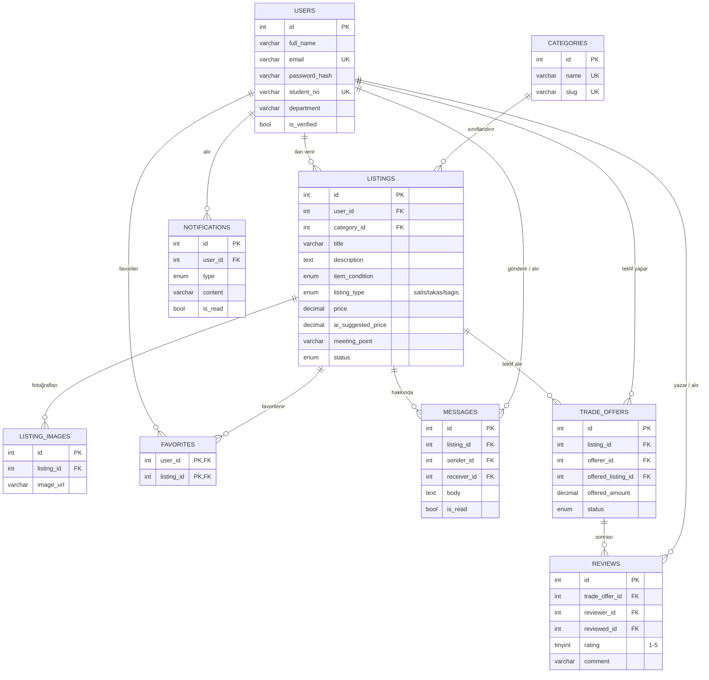

# ER Diyagramı – Kampüs Takas

> GitHub bu diyagramı otomatik çizer. Tablo tanımlarının tamamı: [`backend/database/schema.sql`](../backend/database/schema.sql)

## İlişki Türleri

| Tür | Örnek | Açıklama |
|---|---|---|
| **1-1** | (ileride) `users` – profil ayarları | Bir kullanıcının tek bir ayar kaydı olur. Bu projede ayrı tabloya gerek görülmedi, alanlar `users` içinde. |
| **1-N** | `users` → `listings` | Bir öğrenci çok ilan verebilir, her ilan tek bir öğrenciye aittir (`listings.user_id`). |
| **1-N** | `categories` → `listings` | Bir kategoride çok ilan olur, ilan tek kategoridedir. |
| **N-N** | `users` ↔ `listings` (favori) | Bir öğrenci çok ilanı, bir ilan çok öğrenci tarafından favorilenir. Ara tablo: `favorites` (birleşik birincil anahtar). |

## Normalizasyon

- **1NF:** Her hücrede tek değer var. İlan fotoğrafları virgülle tek sütuna yazılmadı, `listing_images` tablosuna ayrıldı.
- **2NF:** Birleşik anahtarlı `favorites` tablosunda anahtarın yarısına bağlı sütun yok.
- **3NF:** Kategori adı ilanın içinde tekrar yazılmıyor; `category_id` ile `categories` tablosuna bağlanıyor. Kullanıcı adı mesajlara kopyalanmıyor, `sender_id` ile bağlanıyor.
