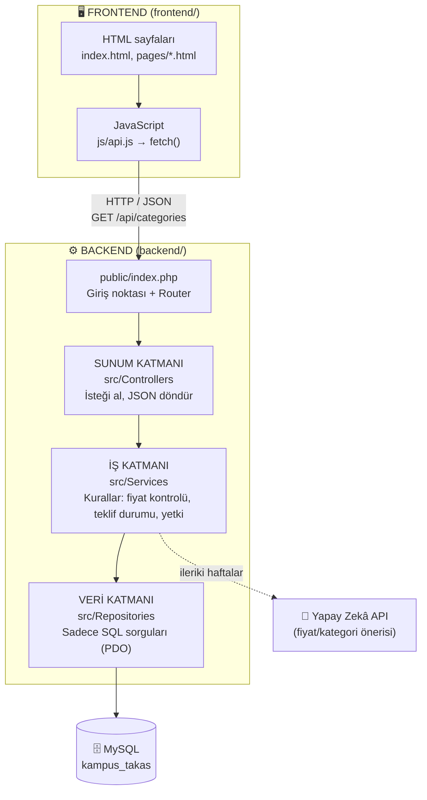

# Mimari Şema – Katmanlı Mimari

Proje **frontend** ve **backend** olarak ikiye ayrılır. Backend kendi içinde üç katmandan oluşur: **sunum → iş → veri**.



## Bir isteğin yolculuğu (örnek: kategorileri listele)

1. `frontend/js/app.js` → `apiGet('/categories')` çağırır.
2. `backend/public/index.php` rotayı bulur → `CategoryController`.
3. `CategoryController` → `CategoryService::list()` çağırır.
4. `CategoryService` → `CategoryRepository::all()` çağırır.
5. Repository SQL'i çalıştırır, sonuç aynı yoldan geri döner ve JSON olarak frontend'e gider.

## Klasör yapısı ve gerekçesi

```
kampus-takas-web-/
├── backend/
│   ├── config/          → Ayarlar. config.php gizli (.gitignore), örneği config.example.php
│   ├── database/        → migrations/ (numaralı .sql), seeds/ (örnek veri), migrate.php, schema.sql
│   ├── tests/           → crud_test.php
│   ├── public/          → Dışarıya açık tek klasör: index.php, .htaccess, uploads/
│   └── src/
│       ├── Core/        → Ortak araçlar: Database, Router, Response
│       ├── Controllers/ → Sunum katmanı
│       ├── Services/    → İş katmanı
│       └── Repositories/→ Veri katmanı
├── frontend/
│   ├── index.html
│   ├── pages/           → Diğer sayfalar
│   ├── css/  js/  assets/
└── docs/                → ER diyagramı, mimari, haftalık raporlar
```

**Neden bu yapı?**
- Sadece `public/` dışarı açık; `config/` ve `src/` tarayıcıdan doğrudan okunamaz (güvenlik).
- Her katmanın tek görevi var: SQL değişince sadece Repository, kural değişince sadece Service değişir.
- Frontend backend'den ayrı olduğu için ileride React/mobil uygulama aynı API'yi kullanabilir.
